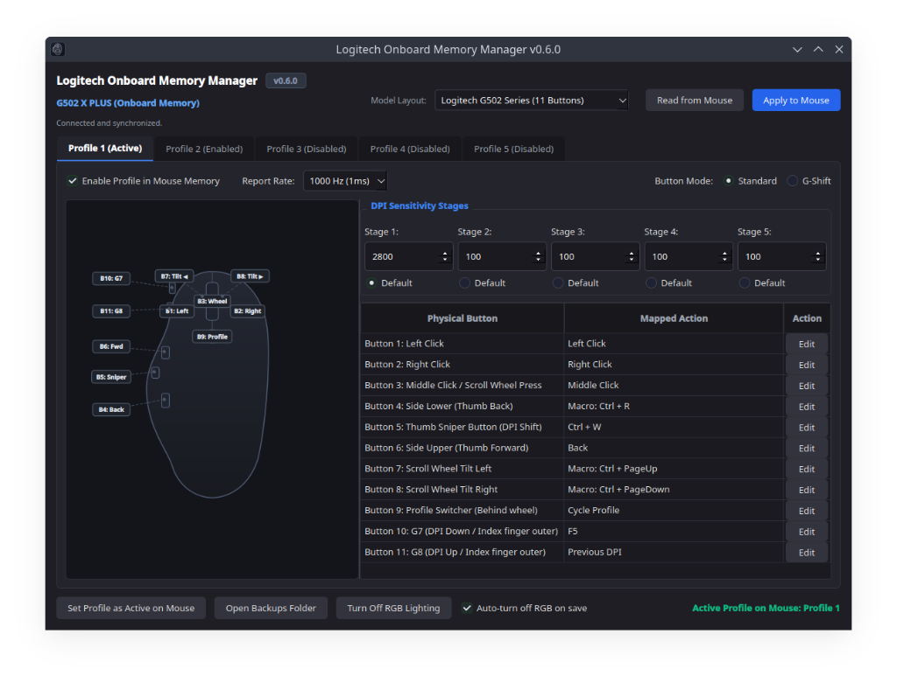
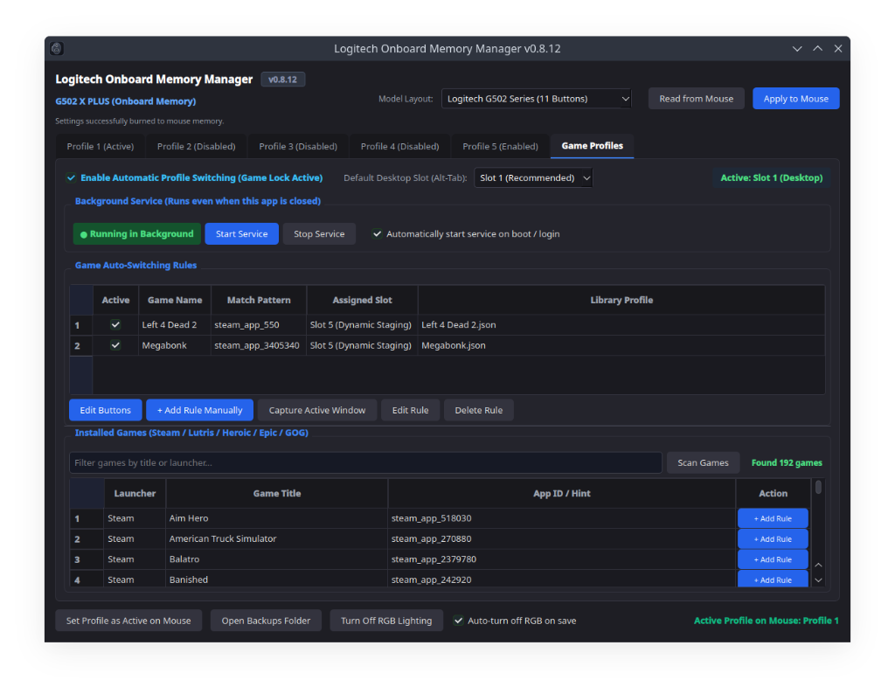
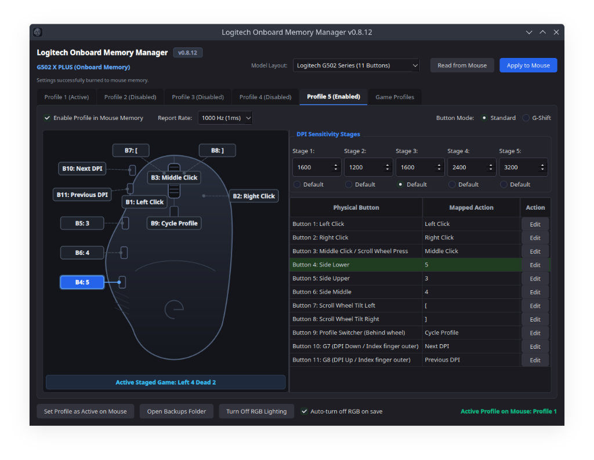

# OMM Linux

A native Linux Onboard Memory Manager and full **Logitech G HUB replacement** for gaming mice. Program button bindings, shortcuts, and DPI stages directly into onboard flash memory with permanent hardware RGB shutoff, without Windows or proprietary bloatware. Includes automatic per-game profile switching, dynamic hardware staging, an integrated game library scanner, and an optional background service to keep profiles synchronized when the app is closed.



---

## Screenshots

| Game Auto-Switching & Background Watcher | Dynamic Profile Staging (Slot 5) |
|:---:|:---:|
|  |  |

---

## Features

- **Direct Hardware Onboard Memory Access**: Communicates directly over `/dev/hidraw*` via raw HID++ 2.0 protocol (`0x8100` Onboard Profiles feature). Edits are burned straight into the mouse flash sectors and persist across computers, operating systems, and reboots.
- **Automatic Game Profile Switching (Game Lock)**:
  - Automatically switches profiles when launching or focusing games (detecting Steam, Lutris, Heroic, Epic, and GOG titles).
  - Dynamic Staging (Slot 5): Instantly flashes game profiles into slot 5 on demand, allowing unlimited game profiles while keeping slots 1-4 intact.
  - Auto-Desktop Return: Instantly returns to your configured default desktop slot upon alt-tabbing or quitting a game.
- **Background Watcher Service**:
  - Optional systemd user daemon (`omm-linux-watcher.service`) keeps auto-switching active in the background even when the GUI is closed.
  - In-app service dashboard with live status badge, Start/Stop toggle, and auto-start on boot configuration.
- **Installed Game Scanner**:
  - One-click scanning for games across Steam, Lutris, and Heroic with filter search and instant rule creation.
- **Physical Button Remapping**:
  - Standard Mouse Buttons (Left, Right, Middle, Back, Forward, Extra buttons)
  - Keyboard Shortcuts & Standalone Modifiers (Interactive recorder capturing single keys, standalone modifiers like Shift/Ctrl/Alt/Super, or complex combinations)
  - Hardware Functions (DPI Shift/Sniper, Next DPI, Previous DPI, Cycle DPI, Profile Switch, Wheel Tilt Left/Right)
  - Disabled / No Action
- **G-Shift Support**: Configure distinct secondary button bindings for G-Shift mode.
- **DPI Profiles & Polling Rate**: Adjust up to 5 DPI sensitivity stages per profile and set report rates (125 Hz, 250 Hz, 500 Hz, 1000 Hz).
- **Multi-Profile Management**: Supports all 5 onboard hardware profile slots with direct active profile switching.
- **Permanent Hardware RGB Shutoff**: Enforces permanent hardware-level LED shutoff (disabling bootUpEffect in hardware NvConfig and zeroing EEPROM lighting zones) so lights stay off even across power cycles.
- **Automated Backups**: Automatically generates timestamped backups before committing changes.
- **Zero Dependencies via AppImage**: Single executable format that runs out of the box on any modern Linux distribution.

---

## Download & Installation

### Option 1: AppImage (Recommended)

Download the latest standalone executable from the [Releases](https://github.com/PlasmaDrifter/Logitech-Onboard-Memory-Manager/releases) page:

```bash
chmod +x OMM-Linux-v0.9.4-x86_64.AppImage
./OMM-Linux-v0.9.4-x86_64.AppImage
```

### Option 2: Running from Source

Requirements: Python 3.10+ and PySide6 (`pip install PySide6 pyyaml`).

```bash
git clone https://github.com/PlasmaDrifter/Logitech-Onboard-Memory-Manager.git
cd Logitech-Onboard-Memory-Manager
./main.py
```

### Option 3: Desktop Menu Integration

To integrate into your KDE Plasma or GNOME desktop launcher:

```bash
./install.sh
```

This creates a symlink in `~/.local/bin/omm-linux`, installs the application icon, and adds the `.desktop` launcher.

### Uninstallation

To cleanly remove desktop integration, command launcher symlinks, and background services:

```bash
./uninstall.sh
```

---

## Building

### Building the AppImage
```bash
./build_appimage.sh
```
The output file will be generated in `dist/OMM-Linux-v0.9.4-x86_64.AppImage`.

### Building a Standalone Binary
```bash
./build_standalone.sh
```
The single-file binary will be generated in `dist/omm-linux`.

---

## Hardware Permissions (udev)

Standard Linux distributions running systemd automatically grant access to user input devices (`/dev/hidraw*`) via `uaccess`.

If running on a minimal or restricted system where non-root access to `/dev/hidraw*` is blocked, install this udev rule:

`/etc/udev/rules.d/99-logitech-hidraw.rules`:
```udev
SUBSYSTEM=="hidraw", ATTRS{idVendor}=="046d", TAG+="uaccess"
```

Reload rules:
```bash
sudo udevadm control --reload-rules && sudo udevadm trigger
```

---

## License

MIT License.
